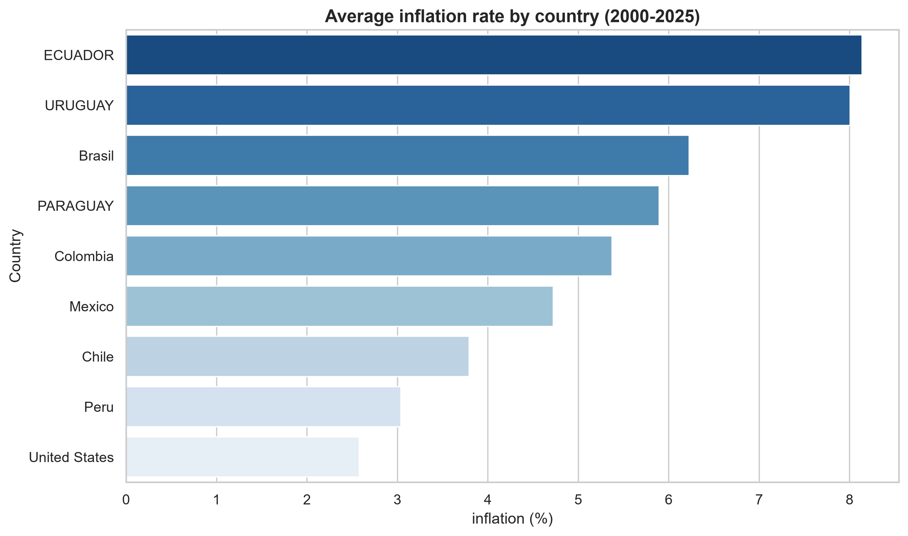
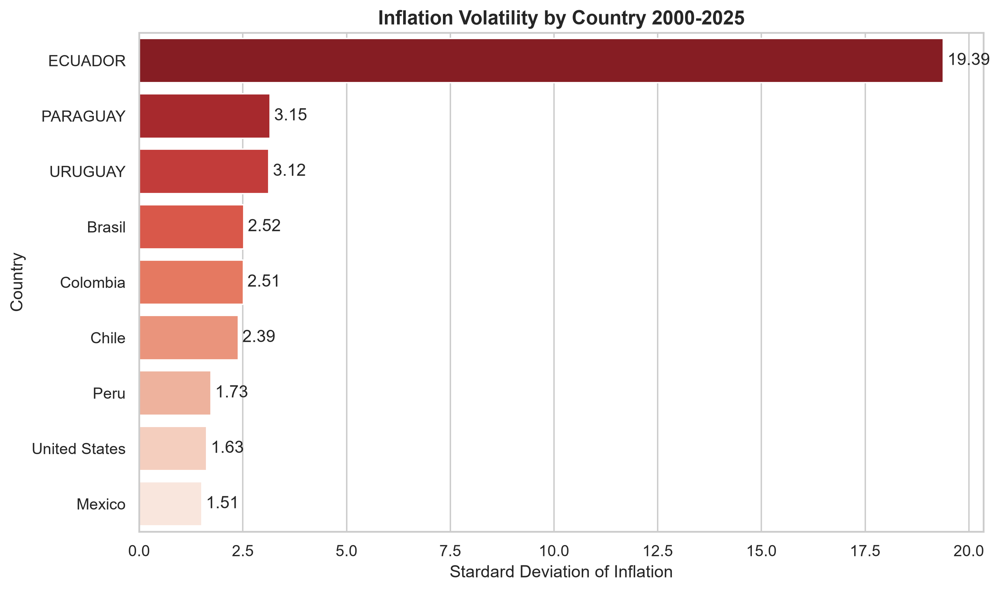
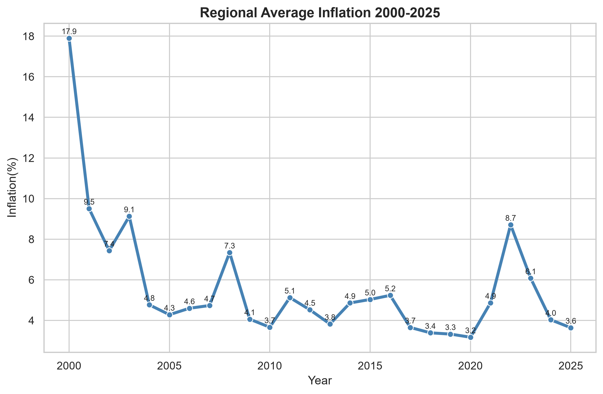
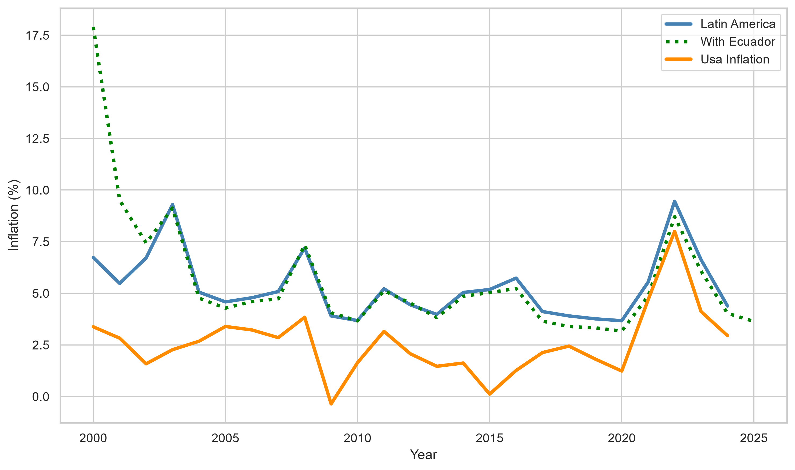

# Latin America Inflation Analysis (2000-2025)

Economic and data analysis project focused on inflation trends across Latin America using Wordl Bank data 
## Why This Project Matters 

Understanding inflation dynamics is critical for policymakers, investors, and researchers. This project demonstrates how publicly available economic data can be transformed into actionable insights through data collection, cleaning, analysis, and visualization.

## Project Objetive
Analyze inflation patterns in Latin America between 2000-2025 using Python and Public economic datasets. 
The objetive is to compare inflation performance across countries, evaluate inflation volatility, identify in Latin America compare with United States 

## Research Questions
 
- Which country experienced the highest average inflation?
- Which country exhibited the highest inflation volatility?
- How did inflation evolve across Latin America between 2000 and 2024?
- How did inflation in Latin America compare with inflation in the United States?
- What was the impact of the post-pandemic inflation surge?

## Data source 
- Wordl Bank (API)
- Indicador: Inflation, consumer prices (annual %)

## Methodology

### 1. Data pretaration 
Data was retrieved directly from the Wordl Bank API using Python and the requests library. 

- Data was transformed from JSON to Pandas DataFrame
- The analysis period was restricted to 2024-2025. 
- Missing values were evaluated and documented. 
- Countries with insufficient data coverage were excluded from analytical dataset. For our study, Venezuela and Argentina were excluded because the majority of the data lacked information.It is important to add that these countries have certainly experienced severe price-level fluctuations, so it would be worthwhile to analyze them separately.

- Clean datasets were exported to the processed data folder.

### 3. Exploratory data analysis: 

- Average inflation by country
- Inflation volatility. 
- Minimum and maximum inflation rates
- Regional inflation trends with Regional inflation with and without Ecuador. This was done this way because, during one of the years analyzed, Ecuador's inflation levels were very high compared to the rest.
- Inflation comparison between Latin America and the United States

### 4. Data Visualization

Visualizations were created using Matplotlib and Seaborn.

## Keys Findings
### Finding 1: Average Inflation 

Countries are ranked according to their average inflation rate during the analysis period. Ecuador is the country with the highest average inflation during the 2000–2025 period (8.13%), Uruguay followed closely with an average inflation rate of 8.00%. whereas the United States was the country with the lowest average inflation (2.57%). 

Overall, the results indicate that Latin American economies experienced persistently higher inflation rates than the United States during the period analyzed.

### Finding 2: Inflation Volatility 

Price stability was evaluated using the standard deviation of annual inflation rates.

 Ecuador implemented a currency adjustment by adopting the U.S. dollar. The results show that Ecuador is the most volatile country in the sample; this result was driven by the 96% inflation rate recorded in the country in the year 2000. 
 
 However, during that same period, Ecuador implemented an economic policy oriented towards dollarization, which contributed to a decrease in prices.Two years after its implementation, the country recorded single-digit inflation, a trend that has been sustained over time.

### Finding 3: Regional inflation trens

Regional inflation reached its highest level in 2000 and increased again during the post-pandemic period, particularly in 2022.
 
Regional inflation accelerated significantly between 2021 and 2022, increasing from 4.85% to 8.63%.
 
Although inflation moderated in 2023, average price growth remained above pre-pandemic levels, suggesting persistent inflationary pressures across the region.

Notably, the United States also experienced elevated inflation (8.00%), suggesting that the inflationary episode was driven by global factors rather than country-specific conditions alone.
 
These results indicate that inflationary pressures following the COVID-19 pandemic affected both Latin American economies and advanced economies alike.

### Finding 4: 
All countries included in the sample experienced elevated inflation rates during 2022.
 
Chile and Colombia recorded the highest inflation rates during that year.

### Finding 5: Latin America vs United States
 
Inflation in Latin America remained consistently above inflation in the United States throughout most of the analysis period.
 
However, the gap narrowed significantly between 2021 and 2023.

 
### Finding 6: Inflation Gap
 
Between 2000 and 2024, inflation in Latin America exceeded inflation in the United States by an average of 2.76 percentage points per year.

## Tools 
- Python
- Pandas
- Numpy
- Matplotlib
- Seaborn
- Git
- GitHub

## Author

Paredes Andrey 

Matemática | Economista 